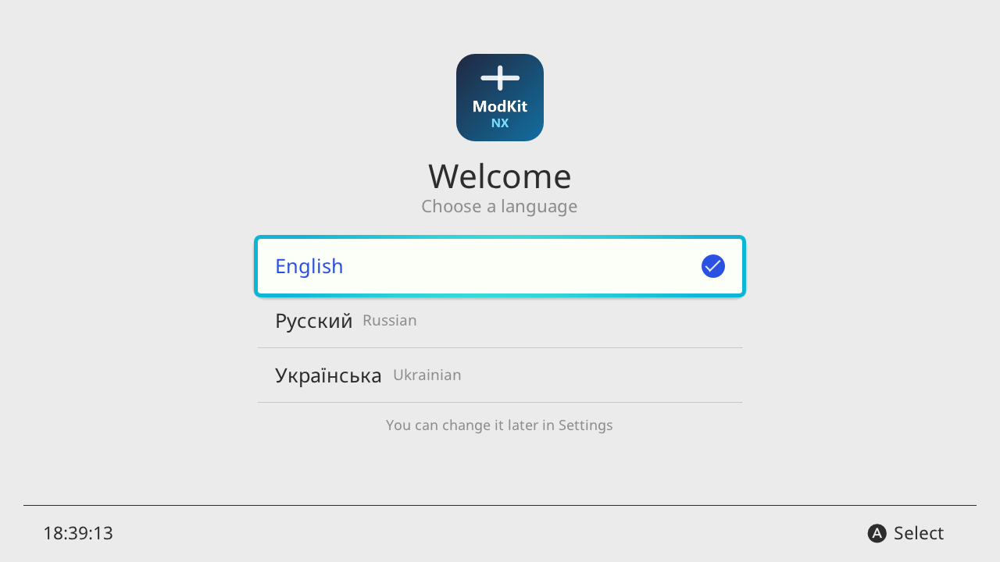
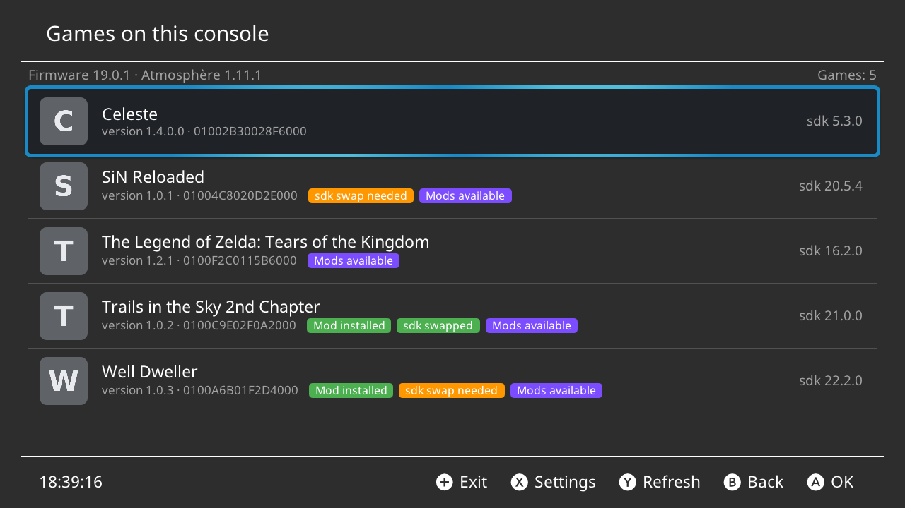
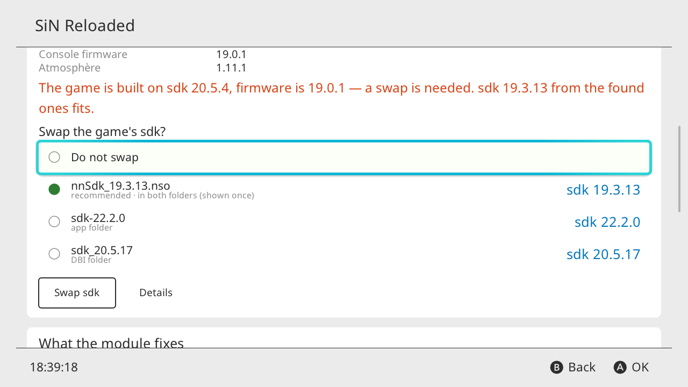
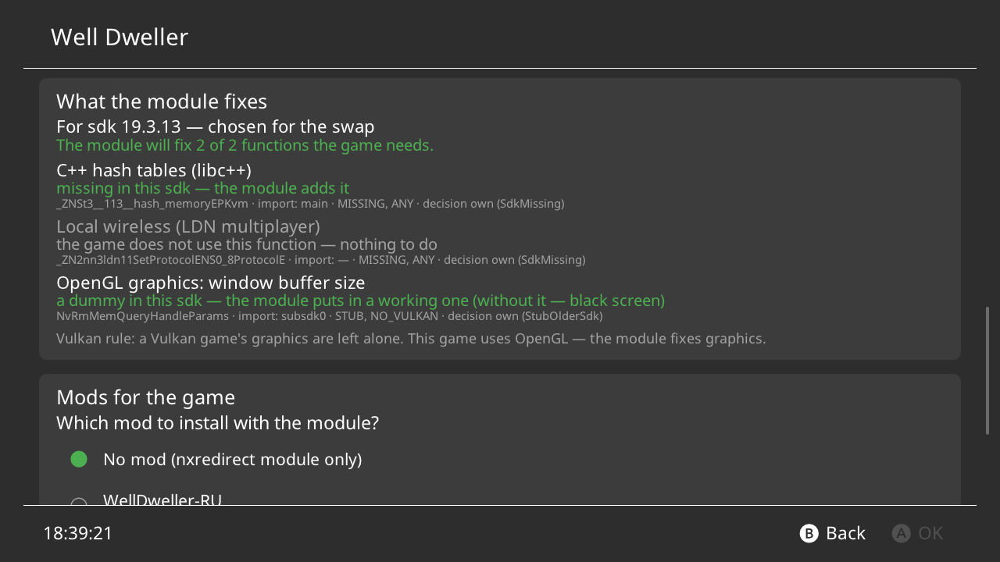
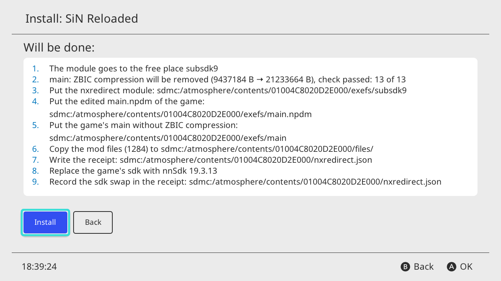
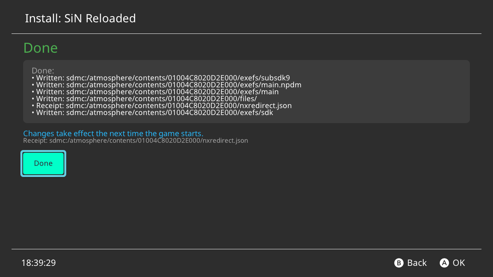
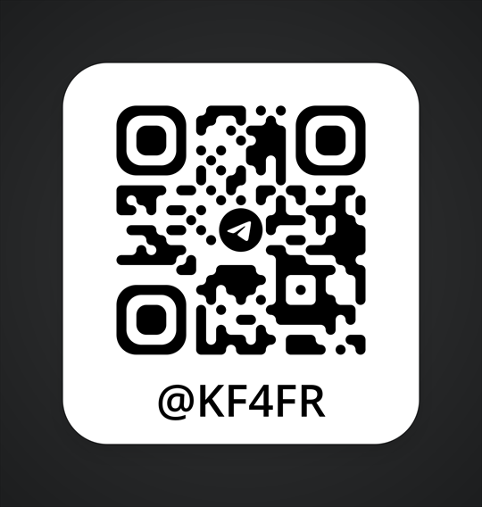

# ModKitNX

Play games made for a newer firmware on yours — right on the Switch. Plus mods without LayeredFS. /
Запускайте игры, рассчитанные на прошивку новее, на своей — прямо на Switch. Плюс моды без LayeredFS.

[English](#english) · [Русский](#русский)

---

## English

**Your console runs firmware 19.0.1, and a new game wants 22.** You don't want to update — or can't. So the game
doesn't start: "Could not start the software", or a black screen.

**ModKitNX** is a homebrew app for a Nintendo Switch with Atmosphère. It prepares such a game to run on *your*
firmware — right on the console, with no PC and no special CFW build.

### What it does

- **Unpacks ZBIC.** Games built for firmware 22 pack their main file in a new format that older Atmosphère cannot
  open. ModKitNX unpacks it once. On firmware 22+ or Atmosphère 1.12+ the system reads ZBIC itself, and the app leaves
  it alone.
- **Swaps the game's sdk** — the set of system libraries inside the game — for one that fits your firmware. Dump it
  from your own console, or press **Find sdk in other games**: the app takes a suitable one from the games you have
  installed. Nothing is downloaded.
- **Adds a small module to the game** that fills in the functions the older sdk lacks or has only as empty stubs.
  One such stub gave Well Dweller a black screen.
- **Grants the game the permissions** the module needs.

One button does it all, and you see the plan first. One button undoes it all: the installed game itself is never
touched — everything lives in its own folder and is removed cleanly.

**Bonus — mods without LayeredFS.** The same module loads translations, graphics and textures directly. LayeredFS
keeps a list of every file of the game in Atmosphère's small memory, and big games with heavy mods don't fit — they
freeze or crash. With ModKitNX they work, on any Atmosphère and any CFW build.

### Who it is for

- You stay on a lower firmware than your games need and don't want to update.
- Your heavy mods or translations freeze through LayeredFS.
- You want a fix that is not tied to one Atmosphère version or one particular CFW build.

### Also

- Each game's page shows what the game needs on your firmware and which sdk fits.
- A debug build and **Collect logs to send** — for when something does not start.
- English, Russian and Ukrainian; a light or dark theme that follows the console; updates itself from GitHub releases.
- Open source, GPL-3.0-or-later.

Built on the work of **Луня (Lunya) — [Langegen](https://github.com/Langegen)**, author of
[TorrentShopNX](https://github.com/Langegen/TorrentShopNX) — see [Thanks](#thanks).

### Screenshots

<table>
<tr><td width="50%"></td><td width="50%"></td></tr>
<tr><td width="50%"></td><td width="50%"></td></tr>
<tr><td width="50%"></td><td width="50%"></td></tr>
</table>

<sub>Rendered on a PC with sample data; light and dark themes.</sub>

### Before → after

Real cases, checked on a console (firmware 19.0.1, Atmosphère 1.11.1). Everything ModKitNX makes lies in the game's
folder `sdmc:/atmosphere/contents/<TitleID>/`.

- **SiN Reloaded** (needs firmware 22.5.0, console on 19.0.1, Atmosphère 1.11.1).
  *Before:* "Could not start the software". *After:* the game works.
  *How:* the game's main file is packed like a zip archive, in the new ZBIC format that older Atmosphère cannot open —
  ModKitNX unpacks it once. And the set of system tools inside the game (the sdk) is made for firmware 22 — ModKitNX
  gives the game the set that fits your firmware.
- **Well Dweller** (the same firmware).
  *Before:* after the same two steps — a black screen. *After:* the game works.
  *How:* the older sdk lacks some functions or has them only as empty stubs. Here the game asks the graphics system
  for the size of its window buffer and gets nothing back. The module ModKitNX adds to the game puts a working
  version in place of the stub. What the module fixes for a game is shown on the game's page.
- **Russian translation of Trails in the Sky 2nd Chapter.**
  *Before:* the game froze at startup; the translation was shipped with a modified Atmosphère (`package3`) that only
  worked on the UltraNX CFW build. *After:* the translation works for everyone, on any Atmosphère and any build.
  *How:* LayeredFS, the usual way to load a mod, keeps a list of all the game's files in Atmosphère's small memory, and
  this game has tens of thousands of them. The module needs no list: when the game opens a file, it hands over the
  mod's file with the same name.
- **Tears of the Kingdom + the UltraCam graphics mod.**
  *Before:* the game crashed with the mod — on firmware 20 and newer system modules get even less memory.
  *After:* the game works with the mod. *How:* the same as Trails — the module loads the mod's files without LayeredFS.

To let the module read the SD card, ModKitNX adds just the permissions it needs to the game's "passport"
(`main.npdm`), and nothing more.

### Installation

1. Copy `ModKitNX.nro` to `sdmc:/switch/ModKitNX/ModKitNX.nro`.
2. **Start it through a game:** launch any installed game **while holding R**. The homebrew menu opens with the
   full memory of a game; start ModKitNX from there.
   If you open it from the Album, the app only shows a screen with this hint and exits — it needs more memory.

### sdk files

Needed for games newer than your firmware. Dump the system library (`nnSdk`) from **your own** console and put the
files into `sdmc:/switch/ModKitNX/sdk/` (subfolders are fine). The app also looks into `sdmc:/switch/DBI/dumps/SDK/`.
Files are recognised by their content, not by name, and the version is shown next to each one.

No suitable sdk file? Every game carries its own sdk inside. On the game's page press **“Find sdk in other games”**:
the app looks through your installed games, offers the sdk that suits your firmware and saves a copy to
`sdmc:/switch/ModKitNX/sdk/`, signed with the game it came from. Nothing is downloaded.

### Adding a mod to a game

If you also want a mod in the game — a translation, graphics — put its folder into

```
sdmc:/switch/ModKitNX/mods/<game name or TitleID>/
```

as its author ships it (`romfs/`, `exefs/`, `.ips` patches or a full `atmosphere/contents/<TitleID>/…` tree). The mod
then appears on the game's page and is added on install. Cheats are not mods here — Atmosphère has its own cheat system.

### If a game or a mod does not work: debug build and logs

1. On the game's page tick **“Debug build”** (right above **Install**) and press **Install**. The regular module is
   replaced cleanly, without leftovers.
2. Start the game once (until it freezes, crashes or shows a black screen), then open ModKitNX again.
3. On the game's page open **“Debug report”**: the app reads the report and says in plain words what went wrong — for
   example, the mod folder is not where it should be, or the first failed graphics call. Reports are kept in
   `sdmc:/switch/ModKitNX/logs/<TitleID>/` (the last 5 starts).
4. To ask for help, press **“Collect logs to send”**. The app puts the game's reports, the latest Atmosphère crash
   report for this game, a short console passport (firmware and Atmosphère versions) and the install receipt into
   `sdmc:/switch/ModKitNX/logs/<Game> v<version>/` and packs them into a `.zip` next to it. There are no keys and no
   game files inside.
5. [Open an issue](../../issues/new/choose) and attach the `.zip`.

When everything works, untick **“Debug build”** and press **Install** again — the regular module goes back in place.

### Console keys (prod.keys)

Only some functions need them. If the app needs them, it says so and shows how to get them. The app never copies or
shows your keys.

How to get `sdmc:/switch/prod.keys` with Lockpick_RCM:

1. Reboot into hekate.
2. Open **Payloads → Lockpick_RCM**.
3. Choose **Dump from SysNAND**.
4. The keys are saved to `sdmc:/switch/prod.keys`.
5. Boot back into Atmosphère and open ModKitNX again.

### Interface languages

English, Русский, Українська. Translations live in `resources/i18n/<language>/`. To add your own language,
see [`TRANSLATING.md`](TRANSLATING.md).

### Building

For developers. You need [devkitPro](https://devkitpro.org/wiki/Getting_Started) (Linux, macOS or WSL) with these
packages, plus CMake 3.16 or newer, make and git:

```sh
sudo dkp-pacman -S --needed switch-dev switch-cmake switch-pkg-config switch-zlib switch-curl switch-glfw switch-mesa switch-libdrm_nouveau switch-glm
```

Then, in the repository root:

```sh
cmake -B build -DPLATFORM_SWITCH=ON -DCMAKE_BUILD_TYPE=Release
cmake --build build -j
```

The result is `build/ModKitNX.nro`. CMake downloads the third-party sources (zstd 1.5.7, LZ4 1.10.0,
nlohmann/json 3.11.3, the xfangfang fork of Borealis at a fixed commit) into the build folder and checks each archive
against a pinned SHA-256 (`cmake/ModkitDeps.cmake`). To build offline, pass `-DMODKIT_DEPS_DIR=<folder>` with
`zstd/`, `lz4/`, `nlohmann/nlohmann/json.hpp` and `borealis/` inside.

With Docker instead of a local devkitPro:

```sh
docker run --rm -v "$PWD":/src -w /src devkitpro/devkita64:20260219 sh -c 'dkp-pacman -Sy --needed --noconfirm switch-dev switch-cmake switch-pkg-config switch-zlib switch-curl switch-glfw switch-mesa switch-libdrm_nouveau switch-glm && cmake -B build -DPLATFORM_SWITCH=ON -DCMAKE_BUILD_TYPE=Release && cmake --build build -j'
```

Core tests on a PC: `cmake -S tests/host -B build-host && cmake --build build-host -j && ctest --test-dir build-host`.

The source of the game module is in `nxredirect/` (GPL-2.0). The modules in `romfs/modules/` can be rebuilt and
compared byte for byte with the shipped ones (Linux or WSL, devkitA64, make, rsync):
`bash nxredirect/build-romfs-modules.sh <output folder> --check romfs/modules`.

### Thanks

Big thanks to **Луня (Lunya) — [Langegen](https://github.com/Langegen)** and
**[TorrentShopNX](https://github.com/Langegen/TorrentShopNX)**: the game list, reading titles and icons, reading the
game's sdk version and the interface setup are based on it.

Heartfelt thanks to the **4IFIR community** — it keeps me motivated, and it is the best:
**[Telegram](https://t.me/kf4fr)** (releases, news and help) ·
**[GitHub](https://github.com/rashevskyv/4ifir-checker/releases)** (the build).

<a href="https://t.me/kf4fr"></a>

Also Borealis (natinusala, xfangfang), Atmosphère, libnx, devkitPro, zstd, LZ4, nlohmann/json and exlaunch
(shadowninja108). Full list — [`THANKS.md`](THANKS.md).

### License

GPL-3.0-or-later — [`LICENSE`](LICENSE). The game module in `nxredirect/` is GPL-2.0 and is shipped inside the app as
separate files. The fix catalog `nxr_autofix_catalog.h`, used by both the module and the app, is GPL-2.0-or-later.

### Disclaimer

Use at your own risk. A console with CFW or modified games can be banned from Nintendo's online services — do not go
online with CFW or modified games. Back up your SD card first. This project is not affiliated with Nintendo.

---

## Русский

**На консоли прошивка 19.0.1, а новая игра требует 22-ю.** Обновляться не хочется — или нельзя. И игра не
запускается: «Не удалось запустить программу» или чёрный экран.

**ModKitNX** — homebrew-приложение для Nintendo Switch с Atmosphère. Оно готовит такую игру к запуску на *вашей*
прошивке — прямо на консоли, без ПК и без особой сборки CFW.

### Что делает

- **Снимает сжатие ZBIC.** Игры под прошивку 22 упаковывают главный файл новым способом, который старая Atmosphère
  не открывает. ModKitNX один раз его распаковывает. На прошивке 22 и новее или с Atmosphère 1.12 и новее система
  читает ZBIC сама, и приложение его не трогает.
- **Подменяет sdk игры** — набор системных библиотек внутри игры — на подходящий вашей прошивке. Снимите его со своей
  консоли или нажмите **«Найти sdk в других играх»**: приложение возьмёт подходящий из ваших установленных игр.
  Ничего не скачивается.
- **Добавляет в игру небольшой модуль**, который восполняет функции, которых в старой sdk нет или которые там пустые
  заглушки. Из-за одной такой заглушки у Well Dweller был чёрный экран.
- **Выдаёт игре права**, нужные модулю.

Всё одной кнопкой, и сначала вы видите план. И одной кнопкой назад: сама установленная игра не меняется — всё лежит в
отдельной папке и убирается начисто.

**Бонус — моды без LayeredFS.** Тот же модуль подключает переводы, графику и текстуры напрямую. LayeredFS держит список
всех файлов игры в небольшой памяти Atmosphère, и большие игры с тяжёлыми модами туда не помещаются — зависают или
падают. С ModKitNX они работают — на любой Atmosphère и любой сборке CFW.

### Для кого

- Вы сидите на прошивке ниже нужной играм и не хотите обновляться.
- Тяжёлые моды и переводы через LayeredFS у вас зависают.
- Вам нужно решение без привязки к версии Atmosphère и к конкретной сборке CFW.

### Ещё

- На странице каждой игры видно, что ей нужно на вашей прошивке и какая sdk подходит.
- Отладочная сборка и кнопка **«Собрать логи для отправки»** — если что-то не запускается.
- Английский, русский и украинский; светлая или тёмная тема — как в системе консоли; обновляется сам из релизов GitHub.
- Открытый код, GPL-3.0-or-later.

Сделано на основе работы **Луни — [Langegen](https://github.com/Langegen)**, автора
[TorrentShopNX](https://github.com/Langegen/TorrentShopNX), — см. [Благодарности](#благодарности).

### Снимки экрана

<table>
<tr><td width="50%"></td><td width="50%"></td></tr>
<tr><td width="50%"></td><td width="50%"></td></tr>
<tr><td width="50%"></td><td width="50%"></td></tr>
</table>

<sub>Отрисовано на ПК с подставными данными; светлая и тёмная темы. Интерфейс на снимках — английский, русский выбирается при первом запуске.</sub>

### Было → стало

Настоящие случаи, проверены на консоли (прошивка 19.0.1, Atmosphère 1.11.1). Всё, что делает ModKitNX, лежит в папке
игры `sdmc:/atmosphere/contents/<TitleID>/`.

- **SiN Reloaded** (нужна прошивка 22.5.0, на консоли 19.0.1, Atmosphère 1.11.1).
  *Было:* «Не удалось запустить программу». *Стало:* игра работает.
  *Как:* главный файл игры упакован, как zip-архив, новым способом ZBIC, который старая Atmosphère не открывает, —
  ModKitNX один раз его распаковывает. А набор системных инструментов внутри игры (sdk) рассчитан на прошивку 22 —
  ModKitNX даёт игре набор под вашу прошивку.
- **Well Dweller** (та же прошивка).
  *Было:* после тех же двух шагов — чёрный экран. *Стало:* игра работает.
  *Как:* в старом sdk каких-то функций нет, а какие-то — пустые заглушки. Здесь игра спрашивает у графики размер
  буфера окна и ничего не получает. Модуль, который ModKitNX добавляет в игру, ставит на место заглушки рабочую
  версию. Что модуль исправит для конкретной игры, видно на её странице.
- **Русификатор Trails in the Sky 2nd Chapter.**
  *Было:* игра зависала при запуске; русификатор выпускали с изменённой Atmosphère (`package3`), которая работала
  только на сборке UltraNX. *Стало:* русификатор работает у всех, на любой Atmosphère и любой сборке.
  *Как:* LayeredFS, обычный способ подключить мод, держит список всех файлов игры в небольшой памяти Atmosphère, а у
  этой игры их десятки тысяч. Модулю список не нужен: когда игра открывает файл, он отдаёт ей файл мода с тем же
  именем.
- **Tears of the Kingdom + графический мод UltraCam.**
  *Было:* игра с модом падала — на прошивках 20 и новее системным модулям памяти ещё меньше.
  *Стало:* игра с модом работает. *Как:* так же, как у Trails, — модуль подключает файлы мода без LayeredFS.

Чтобы модуль мог читать карту памяти, ModKitNX дописывает в «паспорт» игры (`main.npdm`) только нужные ему права —
и больше ничего.

### Установка

1. Скопируйте `ModKitNX.nro` в `sdmc:/switch/ModKitNX/ModKitNX.nro`.
2. **Запускайте через игру:** откройте любую установленную игру, **удерживая R**. Откроется меню homebrew с полной
   памятью игры — запустите ModKitNX оттуда.
   Если открыть через Альбом, приложение покажет экран с этой подсказкой и выйдет — ему нужно больше памяти.

### Файлы sdk

Нужны для игр новее прошивки. Снимите системную библиотеку (`nnSdk`) со **своей** консоли и положите файлы в
`sdmc:/switch/ModKitNX/sdk/` (подпапки можно). Приложение смотрит и в `sdmc:/switch/DBI/dumps/SDK/`. Файл узнаётся
по содержимому, а не по имени; рядом с каждым показывается версия.

Нет подходящей sdk? Она есть внутри каждой игры. На странице игры нажмите **«Найти sdk в других играх»**: приложение
пройдёт по установленным играм, предложит sdk под вашу прошивку и сохранит копию в `sdmc:/switch/ModKitNX/sdk/` с
подписью, из какой она игры. Ничего не скачивается.

### Как добавить к игре мод

Если вместе с этим нужен мод — перевод, графика, — положите его папку в

```
sdmc:/switch/ModKitNX/mods/<название игры или TitleID>/
```

в том виде, как его выпустил автор (`romfs/`, `exefs/`, патчи `.ips` или целое дерево
`atmosphere/contents/<TitleID>/…`). Мод появится на странице игры и подключится при установке. Читы здесь не моды —
у Atmosphère для них своя система.

### Если игра или мод не работает: отладка и логи

1. На странице игры отметьте **«Отладочная сборка»** (прямо над кнопкой **«Установить»**) и нажмите **«Установить»**.
   Обычный модуль заменится начисто, без остатков.
2. Запустите игру один раз (до зависания, вылета или чёрного экрана) и снова откройте ModKitNX.
3. На странице игры откройте **«Отчёт отладки»**: приложение прочитает отчёт и скажет простыми словами, что пошло не
   так — например, папка мода лежит не там или какой вызов графики первым не удался. Отчёты хранятся в
   `sdmc:/switch/ModKitNX/logs/<TitleID>/` (последние 5 запусков).
4. Чтобы попросить помощи, нажмите **«Собрать логи для отправки»**. Приложение сложит отчёты игры, последний отчёт
   Atmosphère о падении этой игры, короткий паспорт консоли (версии прошивки и Atmosphère) и квитанцию установки в
   `sdmc:/switch/ModKitNX/logs/<Игра> v<версия>/` и упакует их в `.zip` рядом. Ключей и файлов игры внутри нет.
5. [Создайте issue](../../issues/new/choose) и приложите `.zip`.

Когда всё заработает, снимите **«Отладочная сборка»** и снова нажмите **«Установить»** — вернётся обычный модуль.

### Ключи консоли (prod.keys)

Нужны только для отдельных функций. Если приложению они понадобятся, оно скажет об этом и покажет, как их снять.
Ключи приложение не копирует и не показывает.

Как получить `sdmc:/switch/prod.keys` программой Lockpick_RCM:

1. Перезагрузитесь в hekate.
2. Откройте **Payloads → Lockpick_RCM**.
3. Выберите **Dump from SysNAND**.
4. Ключи сохранятся в `sdmc:/switch/prod.keys`.
5. Загрузитесь обратно в Atmosphère и снова откройте ModKitNX.

### Языки интерфейса

English, Русский, Українська. Переводы лежат в `resources/i18n/<язык>/`. Как добавить свой язык —
[`TRANSLATING.md`](TRANSLATING.md).

### Сборка

Для разработчиков. Нужен [devkitPro](https://devkitpro.org/wiki/Getting_Started) (Linux, macOS или WSL) с пакетами
ниже, а также CMake 3.16 или новее, make и git:

```sh
sudo dkp-pacman -S --needed switch-dev switch-cmake switch-pkg-config switch-zlib switch-curl switch-glfw switch-mesa switch-libdrm_nouveau switch-glm
```

Затем в корне репозитория:

```sh
cmake -B build -DPLATFORM_SWITCH=ON -DCMAKE_BUILD_TYPE=Release
cmake --build build -j
```

Результат — `build/ModKitNX.nro`. Сторонние исходники (zstd 1.5.7, LZ4 1.10.0, nlohmann/json 3.11.3, Borealis —
форк xfangfang на закреплённом коммите) CMake скачивает в папку сборки и сверяет каждый архив с закреплённым SHA-256
(`cmake/ModkitDeps.cmake`). Без сети: `-DMODKIT_DEPS_DIR=<папка>` с `zstd/`, `lz4/`, `nlohmann/nlohmann/json.hpp` и
`borealis/` внутри.

Через Docker вместо devkitPro на машине:

```sh
docker run --rm -v "$PWD":/src -w /src devkitpro/devkita64:20260219 sh -c 'dkp-pacman -Sy --needed --noconfirm switch-dev switch-cmake switch-pkg-config switch-zlib switch-curl switch-glfw switch-mesa switch-libdrm_nouveau switch-glm && cmake -B build -DPLATFORM_SWITCH=ON -DCMAKE_BUILD_TYPE=Release && cmake --build build -j'
```

Тесты ядра на ПК: `cmake -S tests/host -B build-host && cmake --build build-host -j && ctest --test-dir build-host`.

Исходники модуля для игр — в `nxredirect/` (GPL-2.0). Модули из `romfs/modules/` можно пересобрать и побайтно
сверить с поставленными (Linux или WSL, devkitA64, make, rsync):
`bash nxredirect/build-romfs-modules.sh <папка-выхода> --check romfs/modules`.

### Благодарности

Огромное спасибо **Луне — [Langegen](https://github.com/Langegen)** и
**[TorrentShopNX](https://github.com/Langegen/TorrentShopNX)**: список игр, чтение названий и иконок, чтение версии
sdk игры и устройство интерфейса сделаны по нему.

От всей души спасибо **сообществу 4IFIR** — оно мотивирует, и оно лучшее:
**[Telegram](https://t.me/kf4fr)** (релизы, новости и помощь) ·
**[GitHub](https://github.com/rashevskyv/4ifir-checker/releases)** (сама сборка).

<a href="https://t.me/kf4fr"></a>

А также Borealis (natinusala, xfangfang), Atmosphère, libnx, devkitPro, zstd, LZ4, nlohmann/json и exlaunch
(shadowninja108). Полный список — [`THANKS.md`](THANKS.md).

### Лицензия

GPL-3.0-or-later — [`LICENSE`](LICENSE). Модуль для игр в папке `nxredirect/` — под GPL-2.0, едет внутри приложения
отдельными файлами. Каталог исправлений `nxr_autofix_catalog.h` — общий для модуля и приложения — под GPL-2.0-or-later.

### Отказ от ответственности

На свой риск. Консоль с CFW или изменёнными играми могут заблокировать в онлайн-сервисах Nintendo — не выходите
в сеть с CFW и изменёнными играми. Сначала сделайте копию SD-карты. Проект не связан с Nintendo.
