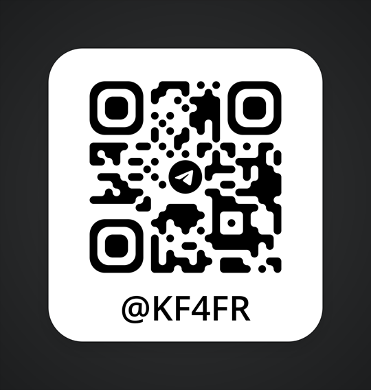

# Thanks

[English](#thanks) · [Русский](#благодарности)

## Lunya (Луня) — Langegen, TorrentShopNX

ModKitNX would not exist in this form without **[TorrentShopNX](https://github.com/Langegen/TorrentShopNX)** by
**Lunya (Луня) — [Langegen](https://github.com/Langegen)** (GPL-3.0). ModKitNX learned from it and adapted:

- the list of installed games through `ns` and `ncm`, title/version/icon from NACP;
- unpacking the compressed NACP title table of SDK 20+ games (`nacp_text.cpp`) — without it new games show garbage names;
- reading the game's SDK version (`sdk_addon_version`, offset 0x21C) from the Program NCA header, with the header key
  derived through `spl` — no `prod.keys` needed;
- detecting mods already installed in `atmosphere/contents/<TID>`, mod layout heuristics;
- the Borealis UI setup (a UI font in romfs `font/font.ttf` for Cyrillic), RU/EN i18n, the "applet mode" warning screen idea;
- background work pattern (`brls::async` / `brls::sync`) and a mutex around system services;
- the idea of checking GitHub `releases/latest` in the background and taking the `.nro` asset (app update).

Every file taken or adapted from TorrentShopNX carries the line
`Based on TorrentShopNX by Langegen (GPL-3.0): <path in the original>`.
This is also why ModKitNX is licensed under GPL-3.0-or-later.

## Duckbill — author of DBI

**Duckbill**, the author of DBI, made **romfsex** — a file redirection module that is not tied to one game. It showed
how to automate the approach for every game; ModKitNX took from it:

- the mod folder inside the game's own folder `atmosphere/contents/<TitleID>/` instead of a fixed path per game;
- a wider list of path prefixes the game uses to open its files;
- logging only in the debug build.

ModKitNX also reads the sdk files that DBI dumps to `sdmc:/switch/DBI/dumps/SDK/`.

## The 4IFIR community

My heartfelt thanks to the **4IFIR community** — it keeps me motivated, and it is the best.

- **[Telegram](https://t.me/kf4fr)** — the 4IFIR group: releases, news and help.
- **[GitHub](https://github.com/rashevskyv/4ifir-checker/releases)** — the 4IFIR build itself.

## Libraries and projects

| Project | Author | Used for | License |
|---|---|---|---|
| [Borealis](https://github.com/xfangfang/borealis) (fork) | natinusala (original), xfangfang (fork) | UI engine | Apache-2.0 |
| [NX-torrent-player](https://github.com/Langegen/NX-torrent-player) | Langegen | idea of a GPU-free text screen in applet mode, of the in-app update (file next to the `.nro`, swap on exit, restart), vendoring practice — no code copied | Apache-2.0 |
| [Atmosphère](https://github.com/Atmosphere-NX/Atmosphere) | SciresM and contributors | the CFW everything runs on; LayeredFS and exefs loading; reference for the ZBIC format | GPL-2.0 (code not included) |
| [Noto Sans](https://github.com/notofonts/latin-greek-cyrillic) (v2.015, subset: Latin, Cyrillic, punctuation) | The Noto Project Authors | UI font `resources/font/font.ttf` (license next to it: `resources/font/OFL.txt`) | SIL OFL 1.1 |
| [libnx](https://github.com/switchbrew/libnx) | switchbrew | system services, file systems | ISC |
| [devkitPro](https://devkitpro.org/) | devkitPro team | devkitA64 toolchain, `switch-*` portlibs (libraries below marked *portlibs*) | various |
| [zstd](https://github.com/facebook/zstd) | Meta (Yann Collet and contributors) | standard zstd decoding (ZBIC frames) | BSD-3-Clause (dual BSD/GPL-2.0) |
| [LZ4](https://github.com/lz4/lz4) | Yann Collet | NSO segment decompression | BSD-2-Clause (`lib/`; the rest of the repository is GPL-2.0-or-later, not used) |
| [nlohmann/json](https://github.com/nlohmann/json) | Niels Lohmann | receipt `nxredirect.json`, settings, caches | MIT |
| [curl / libcurl](https://curl.se/) | Daniel Stenberg and contributors | app update from GitHub releases (*portlibs*, TLS through the console's ssl service) | curl license (MIT-style) |
| [zlib](https://zlib.net/) | Jean-loup Gailly, Mark Adler | compression for libcurl (*portlibs*) | zlib |
| [GLFW](https://github.com/glfw/glfw) | Marcus Geelnard, Camilla Löwy | window and input for the OpenGL renderer (*portlibs*; not in a deko3d build) | zlib |
| [Mesa](https://gitlab.freedesktop.org/mesa/mesa) | Mesa contributors (Switch port: devkitPro) | OpenGL (EGL, glapi) on the console (*portlibs*; not in a deko3d build) | MIT |
| [libdrm](https://gitlab.freedesktop.org/mesa/drm) `libdrm_nouveau` | libdrm contributors (Switch port: devkitPro) | GPU access for Mesa (*portlibs*; not in a deko3d build) | MIT |
| [NanoVG](https://github.com/memononen/nanovg) (with fontstash) | Mikko Mononen | 2D drawing in Borealis (built in from Borealis) | zlib |
| [stb](https://github.com/nothings/stb) (`stb_image`, `stb_truetype`) | Sean Barrett | image and font loading inside NanoVG (built in from Borealis) | public domain / MIT |
| [Yoga](https://github.com/facebook/yoga) | Meta | layout engine of Borealis (built in from Borealis) | MIT |
| [Material Icons](https://github.com/google/material-design-icons) | Google | icon font of Borealis `material/MaterialIcons-Regular.ttf` (license next to it in romfs) | Apache-2.0 |
| [{fmt}](https://github.com/fmtlib/fmt) | Victor Zverovich and contributors | string formatting in Borealis (built in from Borealis) | MIT |
| [Tweeny](https://github.com/mobius3/tweeny) | Leonardo de Freitas, Guilherme R. Costa | animations in Borealis (built in from Borealis) | MIT |
| [TinyXML-2](https://github.com/leethomason/tinyxml2) | Lee Thomason | XML screen layouts in Borealis (built in from Borealis) | zlib |
| [switch-libpulsar](https://github.com/p-sam/switch-libpulsar) | p-sam | system sounds in Borealis (built in from Borealis) | MIT |
| [glad](https://github.com/Dav1dde/glad) | David Herberth | OpenGL loader generated for Borealis (built in from Borealis) | generated code: public domain (WTFPL / CC0) |
| [libretro-common](https://github.com/libretro/libretro-common) (`encoding_utf`, `compat_strl`, `features_cpu`) | The RetroArch team | UTF-8 helpers in Borealis (built in from Borealis) | MIT |
| [exlaunch](https://github.com/shadowninja108/exlaunch) | shadowninja108 | base of the nxredirect exefs module | GPL-2.0 |
| nxredirect | this project's author | the exefs file-redirect module shipped in romfs as separate files (aggregation) | GPL-2.0 |
| Lockpick_RCM | shchmue and forks (the original GitHub repository is unavailable) | recommended for dumping console keys (not bundled) | GPL-2.0 |

All libraries above marked *portlibs* or *built in from Borealis* are linked into `ModKitNX.nro`. Pinned versions and
SHA-256 of the downloaded sources (zstd, LZ4, nlohmann/json, Borealis): `cmake/ModkitDeps.cmake`.

ModKitNX is not affiliated with Nintendo or with any of the projects above.

---

# Благодарности

## Луня — Langegen, TorrentShopNX

Без **[TorrentShopNX](https://github.com/Langegen/TorrentShopNX)** автора **Луни — [Langegen](https://github.com/Langegen)**
(GPL-3.0) ModKitNX в таком виде не было бы. Оттуда взяты и переделаны:

- список установленных игр через `ns` и `ncm`, название, версия и иконка из NACP;
- распаковка сжатой таблицы названий NACP у игр SDK 20+ (`nacp_text.cpp`) — без неё у новых игр «мусор» вместо названий;
- чтение версии SDK игры (`sdk_addon_version`, смещение 0x21C) из заголовка Program NCA ключом, который выводит `spl`, —
  без `prod.keys`;
- поиск модов, уже установленных в `atmosphere/contents/<TID>`, разбор раскладки мода;
- настройка Borealis (свой шрифт в romfs `font/font.ttf` — ради кириллицы), i18n RU/EN, идея экрана «режим апплета»;
- фоновая работа (`brls::async` / `brls::sync`) и мьютекс вокруг системных служб;
- идея фоновой проверки `releases/latest` на GitHub и ассета `.nro` (обновление приложения).

В шапке каждого взятого или переделанного файла — строка
`Based on TorrentShopNX by Langegen (GPL-3.0): <путь в оригинале>`. Поэтому и лицензия ModKitNX — GPL-3.0-or-later.

## Duckbill — автор DBI

**Duckbill**, автор DBI, сделал **romfsex** — модуль подмены файлов, не привязанный к одной игре. Он показал, как
автоматизировать подход для любой игры; ModKitNX взял из него:

- папка мода внутри папки игры `atmosphere/contents/<TitleID>/` вместо своего пути под каждую игру;
- расширенный список префиксов путей, которыми игра открывает файлы;
- логирование только в отладочной сборке.

Кроме того, ModKitNX читает sdk, которые DBI снимает в `sdmc:/switch/DBI/dumps/SDK/`.

## Сообщество 4IFIR

От всей души спасибо **сообществу 4IFIR** — оно мотивирует, и оно лучшее.

- **[Telegram](https://t.me/kf4fr)** — группа 4IFIR: релизы, новости и помощь.
- **[GitHub](https://github.com/rashevskyv/4ifir-checker/releases)** — сама сборка 4IFIR.

## Библиотеки и проекты

| Проект | Автор | Для чего | Лицензия |
|---|---|---|---|
| [Borealis](https://github.com/xfangfang/borealis) (форк) | natinusala (оригинал), xfangfang (форк) | движок интерфейса | Apache-2.0 |
| [NX-torrent-player](https://github.com/Langegen/NX-torrent-player) | Langegen | идеи текстового экрана без GPU в режиме апплета и обновления из приложения (файл рядом с `.nro`, замена при выходе, перезапуск), подход к сторонним исходникам — код не копировался | Apache-2.0 |
| [Atmosphère](https://github.com/Atmosphere-NX/Atmosphere) | SciresM и участники | CFW, на которой всё работает; LayeredFS и загрузка exefs; эталон формата ZBIC | GPL-2.0 (код не включён) |
| [Noto Sans](https://github.com/notofonts/latin-greek-cyrillic) (v2.015, подмножество: латиница, кириллица, знаки) | The Noto Project Authors | шрифт интерфейса `resources/font/font.ttf` (лицензия рядом: `resources/font/OFL.txt`) | SIL OFL 1.1 |
| [libnx](https://github.com/switchbrew/libnx) | switchbrew | системные службы, файловые системы | ISC |
| [devkitPro](https://devkitpro.org/) | команда devkitPro | тулчейн devkitA64, портлибы `switch-*` (ниже помечены *портлибы*) | разные |
| [zstd](https://github.com/facebook/zstd) | Meta (Yann Collet и участники) | обычная распаковка zstd (кадры ZBIC) | BSD-3-Clause (двойная BSD/GPL-2.0) |
| [LZ4](https://github.com/lz4/lz4) | Yann Collet | распаковка сегментов NSO | BSD-2-Clause (`lib/`; остальной репозиторий — GPL-2.0-or-later, не используется) |
| [nlohmann/json](https://github.com/nlohmann/json) | Niels Lohmann | квитанция `nxredirect.json`, настройки, кэши | MIT |
| [curl / libcurl](https://curl.se/) | Daniel Stenberg и участники | обновление приложения из релизов GitHub (*портлибы*, TLS через службу ssl консоли) | лицензия curl (в духе MIT) |
| [zlib](https://zlib.net/) | Jean-loup Gailly, Mark Adler | сжатие для libcurl (*портлибы*) | zlib |
| [GLFW](https://github.com/glfw/glfw) | Marcus Geelnard, Camilla Löwy | окно и ввод для отрисовки через OpenGL (*портлибы*; нет в сборке deko3d) | zlib |
| [Mesa](https://gitlab.freedesktop.org/mesa/mesa) | участники Mesa (порт на Switch: devkitPro) | OpenGL (EGL, glapi) на консоли (*портлибы*; нет в сборке deko3d) | MIT |
| [libdrm](https://gitlab.freedesktop.org/mesa/drm) `libdrm_nouveau` | участники libdrm (порт на Switch: devkitPro) | доступ Mesa к GPU (*портлибы*; нет в сборке deko3d) | MIT |
| [NanoVG](https://github.com/memononen/nanovg) (с fontstash) | Mikko Mononen | 2D-отрисовка в Borealis (входит в Borealis) | zlib |
| [stb](https://github.com/nothings/stb) (`stb_image`, `stb_truetype`) | Sean Barrett | загрузка картинок и шрифтов в NanoVG (входит в Borealis) | общественное достояние / MIT |
| [Yoga](https://github.com/facebook/yoga) | Meta | раскладка экранов Borealis (входит в Borealis) | MIT |
| [Material Icons](https://github.com/google/material-design-icons) | Google | шрифт значков Borealis `material/MaterialIcons-Regular.ttf` (лицензия рядом в romfs) | Apache-2.0 |
| [{fmt}](https://github.com/fmtlib/fmt) | Victor Zverovich и участники | форматирование строк в Borealis (входит в Borealis) | MIT |
| [Tweeny](https://github.com/mobius3/tweeny) | Leonardo de Freitas, Guilherme R. Costa | анимации в Borealis (входит в Borealis) | MIT |
| [TinyXML-2](https://github.com/leethomason/tinyxml2) | Lee Thomason | XML-разметка экранов в Borealis (входит в Borealis) | zlib |
| [switch-libpulsar](https://github.com/p-sam/switch-libpulsar) | p-sam | системные звуки в Borealis (входит в Borealis) | MIT |
| [glad](https://github.com/Dav1dde/glad) | David Herberth | загрузчик OpenGL, сгенерированный для Borealis (входит в Borealis) | сгенерированный код: общественное достояние (WTFPL / CC0) |
| [libretro-common](https://github.com/libretro/libretro-common) (`encoding_utf`, `compat_strl`, `features_cpu`) | команда RetroArch | работа с UTF-8 в Borealis (входит в Borealis) | MIT |
| [exlaunch](https://github.com/shadowninja108/exlaunch) | shadowninja108 | основа exefs-модуля nxredirect | GPL-2.0 |
| nxredirect | автор этого проекта | exefs-модуль подмены файлов, лежит в romfs отдельными файлами (агрегация) | GPL-2.0 |
| Lockpick_RCM | shchmue и форки (исходный репозиторий на GitHub недоступен) | рекомендуется, чтобы снять ключи консоли (в комплект не входит) | GPL-2.0 |

Все библиотеки с пометками *портлибы* и *входит в Borealis* собраны в `ModKitNX.nro`. Закреплённые версии и SHA-256
скачиваемых исходников (zstd, LZ4, nlohmann/json, Borealis) — в `cmake/ModkitDeps.cmake`.

ModKitNX не связан с Nintendo и с перечисленными проектами.
